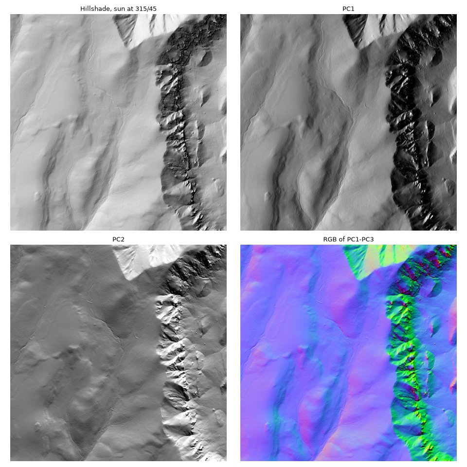

# disco-tif

Principal-component hillshades for digital elevation models, at any raster size.



*A 2.5 km crop of a 1 m USGS 3DEP LiDAR tile near Blue Mesa Reservoir, Colorado. Top left is an ordinary hillshade with the sun at azimuth 315 and altitude 45. The other panels are the first two principal components of 16 hillshades (8 azimuths at 30 and 60 degrees) and the RGB composite of the first three. Made by the [example notebook](example_notebooks/hillshade_pca_example.ipynb).*

A single hillshade hides every feature that runs parallel to its sun. The usual fix is to shade from many directions and reduce the stack with principal component analysis, so the first few components carry the relief from all of them (Devereux et al. 2008). disco-tif does that without ever building the stack, which makes it fast and lets it stream rasters of any size in fixed memory.

## Install

```bash
pip install disco-tif
```

It needs only numpy and rasterio.

## Quick start

From the command line:

```bash
disco-tif hspca dtm.tif
```

That writes `dtm_hspca_c1.tif`, `_c2.tif` and `_c3.tif` (one uint8 GeoTIFF per component), `dtm_hspca_rgb.tif` (the three as an RGB composite) and `dtm_hspca_basis.json` next to the DEM. Use `--out-dir` to put them elsewhere, and `disco-tif hspca --help` for the sun angles, the stretch and the other options.

From Python:

```python
import disco_tif

products = disco_tif.hillshade_pca("dtm.tif", "out/")
products["c1"]   # path to the first component
```

## Many tiles, one basis

To give a set of tiles or survey blocks the same color scale, fit one basis to all of them and apply it to each:

```bash
disco-tif fit-basis tile_*.tif -o basis.json
disco-tif apply-basis basis.json tile_*.tif --out-dir out/
```

or in Python:

```python
basis = disco_tif.fit_basis(["tile_1.tif", "tile_2.tif"])
for dem in ["tile_1.tif", "tile_2.tif"]:
    disco_tif.apply_basis(dem, basis, "out/")
```

The basis is exactly the one you would get from a mosaic of all the inputs, without building the mosaic. The basis JSON records the sun angles, the eigenvalues, the stretch and the inputs, so the same basis can be applied to new tiles later.

One caveat: tiles cut from one DEM have no neighbor across their shared edge, so the cells on either side of a seam get one-sided gradients and differ slightly from a whole read. For one seamless product, run on a GDAL VRT of the tiles, which disco-tif reads block by block like any other raster:

```bash
gdalbuildvrt mosaic.vrt tile_*.tif
disco-tif hspca mosaic.vrt
```

Inputs whose cell sizes differ by more than a factor of 2 are refused, since slopes at different resolutions are not comparable. Pass `--allow-mixed-resolution` to override.

## How it works

An unclipped hillshade is the dot product of the unit surface normal with the unit vector toward the sun. A stack of N hillshades is therefore the normals times an N-by-3 matrix of sun vectors, and its covariance has rank 3 at most, however many suns are used. Everything the PCA needs is the 3x3 covariance of the normals, and the component scores are a fixed linear combination of the normal's east, north and up parts.

So disco-tif reads the DEM in blocks (with a one-cell halo, so block edges do not show), adds up the moments of the normals, solves a 3x3 eigenproblem, and makes a second pass to write the products. Memory is set by the block size, not the raster size. A 1 m LiDAR tile of 100 million cells takes about 35 s and 450 MB on a laptop, and the 16 hillshades are never computed.

Other details:

- Gradients use the real cell spacing from the CRS, including geographic CRSs, where the east spacing shrinks with latitude. Set the elevation unit with `--z-units` (`m`, `ft` or `us_ft`) when it differs from the CRS unit.
- Components have a fixed sign: PC1 correlates positively with the hillshade at azimuth 315 and altitude 45, so it reads like a normal hillshade, and PC2 and PC3 have their largest weight positive. Reruns and different tiles give the same signs.
- The uint8 products stretch each component between its 1st and 99th percentiles to values 1-255, with 0 as nodata. `--dtype float32` writes the raw scores with NaN as nodata instead.
- When PC1 and PC2 explain nearly the same variance, which happens with evenly spaced suns on terrain without a dominant grain, their order and orientation are arbitrary. disco-tif logs a warning and records the eigenvalue ratios in the basis JSON.
- `disco-tif hillshade` writes a single hillshade with the same real-spacing gradients.

## Prior art

- Devereux, B. J., Amable, G. S. and Crow, P. (2008). Visualisation of LiDAR terrain models for archaeological feature detection. Antiquity 82(316), 470-479. PCA of many hillshades.
- [Relief Visualization Toolbox](https://github.com/EarthObservation/RVT_py) and GRASS [r.shaded.pca](https://grass.osgeo.org/grass-stable/manuals/addons/r.shaded.pca.html) both compute hillshade PCA from an explicit stack of hillshades held in memory.

## History

disco-tif started at EMerald Geomodelling as a set of tools for colorizing and hillshading GeoTIFFs. Version 0.1.0 is a rewrite around the closed-form hillshade PCA and drops the colorizing, lookup-table and mapfile functions. Pin `disco-tif<0.1` to keep the old API. See [HISTORY.md](HISTORY.md).

## License

MIT. See [LICENSE.md](LICENSE.md).
